# MONKAYIER — Diagramme Entité-Relation (ERD V1)

> **Projet** : MONKAYIER  
> **Phase** : Phase 1 — Modèle de données & Schéma relationnel PostgreSQL  
> **Source** : `database/schema_v1_postgresql.sql`

---

## 1. Vue Globale des Domaines Clés

```mermaid
erDiagram
    COUNTRIES ||--o{ ACADEMIC_YEARS : "definit"
    COUNTRIES ||--o{ EDUCATION_LEVELS : "structure"
    COUNTRIES ||--o{ SUBJECTS : "enseigne"
    EDUCATION_LEVELS ||--o{ SCHOOL_SERIES : "specialise"
    
    ACADEMIC_YEARS ||--o{ CURRICULA : "programme_pour"
    EDUCATION_LEVELS ||--o{ CURRICULA : "niveau_de"
    CURRICULA ||--o{ CURRICULUM_TOPICS : "decoupe_en"
    CURRICULUM_TOPICS ||--o{ CURRICULUM_OBJECTIVES : "evalue_par"
    
    USERS ||--|| USER_PROFILES : "possede"
    USERS ||--o{ USER_ROLES : "a_pour"
    ROLES ||--o{ USER_ROLES : "assigne_a"
    USERS ||--o{ USER_DEVICES : "utilise"
    
    SCHOOLS ||--o{ CLASSES : "heberge"
    CLASSES ||--o{ CLASS_MEMBERSHIPS : "inscrit"
    USERS ||--o{ CLASS_MEMBERSHIPS : "participe"
    CLASSES ||--o{ CLASS_SUBJECTS : "dispense"
    
    CURRICULA ||--o{ LEARNING_RESOURCES : "illustre"
    SUBJECTS ||--o{ LEARNING_RESOURCES : "classe"
    LEARNING_RESOURCES ||--o{ RESOURCE_VERSIONS : "versionne"
    RESOURCE_VERSIONS ||--o{ RESOURCE_CHUNKS : "decoupe_pour_rag"
    RESOURCE_VERSIONS ||--o{ RESOURCE_PAGES : "pages"
    
    LEARNING_RESOURCES ||--o{ ASSESSMENTS : "evalue_sur"
    ASSESSMENTS ||--o{ ASSESSMENT_QUESTIONS : "contient"
    ASSESSMENT_QUESTIONS ||--o{ QUESTION_OPTIONS : "propose"
    ASSESSMENT_QUESTIONS ||--o{ QUESTION_ANSWERS : "corrige_par"
    
    ASSESSMENTS ||--o{ ASSESSMENT_ATTEMPTS : "passe"
    USERS ||--o{ ASSESSMENT_ATTEMPTS : "eleve"
    ASSESSMENT_ATTEMPTS ||--o{ ATTEMPT_ANSWERS : "repond"
    
    USERS ||--o{ AI_CONVERSATIONS : "dialogue_avec"
    AI_CONVERSATIONS ||--o{ AI_MESSAGES : "echange"
    AI_MESSAGES ||--o{ AI_MESSAGE_SOURCES : "cite"
    RESOURCE_CHUNKS ||--o{ AI_MESSAGE_SOURCES : "source_de"
    
    CLASSES ||--o{ ASSIGNMENTS : "donne_a"
    ASSIGNMENTS ||--o{ ASSIGNMENT_SUBMISSIONS : "rendu_par"
    USERS ||--o{ ASSIGNMENT_SUBMISSIONS : "copie_eleve"
    ASSIGNMENT_SUBMISSIONS ||--o{ SUBMISSION_GRADES : "note_par_prof"
    ASSIGNMENT_SUBMISSIONS ||--o{ AI_GRADING_SUGGESTIONS : "suggestion_ia"
    
    USERS ||--o{ PARENT_STUDENT_LINKS : "parent"
    USERS ||--o{ PARENT_STUDENT_LINKS : "enfant"
    
    COUNTRIES ||--o{ CALENDAR_EVENTS : "calendrier_de"
    CALENDAR_SOURCES ||--o{ CALENDAR_EVENTS : "officialise"
    CALENDAR_SOURCES ||--o{ EXAM_SESSIONS : "publie"
    
    USERS ||--o{ SOLIDARITY_REQUESTS : "demande"
    SOLIDARITY_REQUESTS ||--o{ SOLIDARITY_DOCUMENTS : "justifie"
    SOLIDARITY_REQUESTS ||--o{ SOLIDARITY_DECISIONS : "accorde_refuse"
```

---

## 2. Principes d'Intégrité Modélisés

1. **Isolation & Traçabilité RAG** :
   * Chaque ressource pédagogique (`learning_resources`) est versionnée de façon immuable (`resource_versions`).
   * Les fragments RAG (`resource_chunks`) portent une référence de page (`resource_pages`) et de source officielle (`resource_sources`).
   * Tout message IA (`ai_messages`) peut être lié à un fragment précis via `ai_message_sources` pour afficher un badge de vérification cliquable dans l'interface élève.

2. **Évaluations & Anti-Fraude / Résilience Réseau** :
   * Les tentatives (`assessment_attempts`) portent une clé d'idempotence unique par élève (`idempotency_key`), évitant toute duplication lors d'une reconnexion 3G/4G.
   * Les options correctes (`is_correct`) et les corrigés détaillés (`question_answers`) ne sont jamais exposés au client avant la validation serveur de la tentative.

3. **Protection des Mineurs & Espace Parents** :
   * La relation parent-enfant (`parent_student_links`) requiert un code de liaison haché (`parent_link_codes`) et une validation explicite.
   * Aucun lien direct entre `parent_user_id` et les conversations intimes de l'élève (`ai_conversations`).
